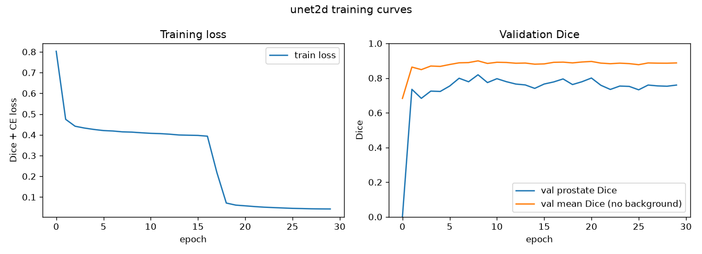
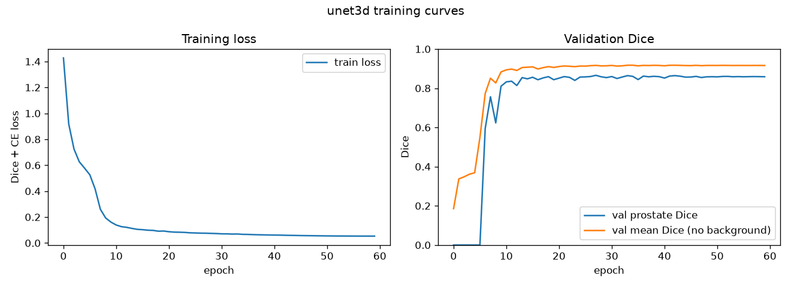
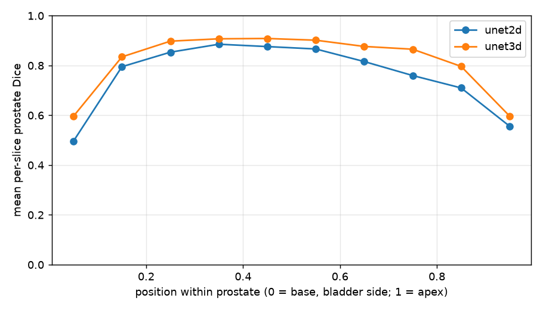

# Documentation via README.md - 10 Marks
Once your algorithm has been implemented, you will need to provide sufficient comments in your
code and comprehensive documentation of your algorithm in a README.md file. The readme file should
contain:
- A title, a description of the algorithm and the problem that it solves (approximately a paragraph),
how it works in a paragraph, and a figure/visualisation.
- Your one-page written feasibility review from Section 3.
- Any dependencies required, including exact versions, and address reproducibility of results.
- Example inputs, outputs, and visual plots of your algorithm.
- Description of any specific pre-processing used, with references if any. Justify your training,
validation, and testing splits of the data.
- Investigation of the Open Research Dilemma:
- Quantitative benchmarking of your chosen model against your implemented baseline model under
identical evaluation splits.
14
- Resource profiling table documenting computational efficiency (peak GPU VRAM, parameter
count, and inference runtime/latency).
- In-depth qualitative error autopsies analyzing 3–5 representative failure cases from the dataset
(diagnosing root triggers and failure modes).
- Actionable engineering recommendation and trade-off synthesis for your project manager.
- The mandatory Artificial Intelligence Usage Disclosure subsection (see Section 6).
Marking Criteria:
1. Description and explanation of the working principles of the algorithm implemented and the problem
it solves (5 Marks).
2. Description of usage and comments throughout scripts (3 marks).
3. Proper formatting using GitHub markdown (2 marks).

---

# 2D vs 3D U-Net for Prostate Segmentation in Radiotherapy MRI (HipMRI)

## 1. Algorithm and Problem Description
External-beam radiotherapy for prostate cancer requires the prostate to be contoured on all MRI slices with millimeter precision. Under-contouring poses a risk of tumor reoccurence, and over-contouring can irradiate neighboring organs and tissue potentially causing inflammation and damage. Manually contouring is a slow and tedious process, hence, this project tests a deep-learning drafting assistant that proposes contours for a specialist to review. The investigation is the dilemma of spatial context in this model. A 2D model segments each slice on its own and is relatively cheap to train, while a 3D model can use the spatial context of the whole 3D volume and in theory should produce more continuous contours. This project trains both models on the same patient-level split and measures the difference that 3D context makes.

**How it works:** Both models are the same U-Net, built from the same class in 'modules.py'. The only difference between the two models is the use of 2D or 3D convolution blocks. The encoder applies two 3x3 convolutions with BatchNorm and ReLU at each level of the U-Net, and then uses max-pooling to halve the resolution. This is repeated 4 times for the downsampling half, with channels doubling consecutively from 16 to 256. The decoder then upsamples with transposed (up) convolutions and concatenates the matching encoder features (skip connections). A 1x1 convolution then outputs one score per class for each pixel/voxel.

The loss used is cross entropy plus (1 - mean soft Dice).
- cross entropy gives stable early gradients, and Dice prevents the background from skewing results as the prostate only accounts for a small ratio of pixels/voxels. The 2D model is trained on individual axial slices, with the 3D model trained on the full volumes. For the testing, the 2D model predicts all slices of a given volume and the slices are stacked back together, <ins>so both models are scored on the same voxels.</ins>


*Figure 1: Basic U-Net architecture as provided in the lecture slides*


*Figure 2: U-Net architecture used for both the 2D and 3D U-Net models. Only difference is the convolution dimensions*


## 2. Feasibility Review
### User Need, Focus, and Acceptance Criteria
User is a radiotherapy imaging specialist that works with anatomical contours of the prostate gland
Prototype purpose: to investigate whether the true 3d volumetric continuity of a 3D U-Net model can eliminate the boundary and slice-transition errors of a 2D U-Net baseline in prostate radiotherapy planning, or if it only refines the easy central slices while consuming much more compute.
### Acceptance criteria
- Prostate label dice sim. >= 0.75 for 2d U-Net, global dice sim. >= 0.7 for 3d U-Net (test patients)
    - Global dice similarity may not capture the success of the model for the base and apex slices, but provides a good validity check
- Stratified Dice similarity by slice position (base, mid, apex) accompanied by HD95 to quantify the gap between predicted boundary and ground truth for each stratum.
    - This helps determine and quantify where 3D U-Net differs from 2D U-Net for each primary area of the prostate scans.
- Peak GPU VRAM and inference time per volume stays under 4 GB/5 seconds for 2D U-Net and 12 GB/15 seconds for 3D U-Net
### Model Choice & Course Concepts
- Dataset configuration:
    - HipMRI study: 38 patients, 211 3d volumes, labels: body, bone, bladder, rectum, prostate. 
    - Patient-level splitting: all slices from a given patient end up in the same train/validation/test split. Prevents leakage between sets. typical split ratio to be ## used: 70/15/15 -> 26/6/6 patients. 
- Preprocessing: 
    - Normalise image intensity per image using z-score; One-hot encoding for labels
- Model architecture:
    - 4 levels (3 downsamples)
    - Filters starting at 32/16, doubling each level.
    - Block: 2 x (3x3 conv, norm, ReLU) (3d convolution for 3D UNet)
    - Models kept similar in architecture aside from increase in convolution dimension – this should allow test results to better reflect the effectiveness of using a 3D UNet over a 2D one. 
### Preliminary Feasibility Evidence:
Initial Data Audit: scans are of 38 patients some over a period of up to 7 weeks of radiotherapy – for the 3d data it is difficult to tell what scans belong to a single patient.
Results of baseline smoke-test experiment/resource estimate for TinyUNet3d on cloud-hosted GPU: 
- (64, 64, 32) peak VRAM: 0.07 GiB
- (128, 128, 64) peak VRAM: 0.56 GiB
### Risks, Budget, and Fallback
Training 3D-UNet may exceed memory or time limitations – mitigation: train using sub-sections to begin with; mixed precision training, possibly lower input resolution if needed
Only 38 patients – stratified results may be noisy, and test set only contains 6 patients with the proposed splitting ratio. Treatment: report per-patient values for test set. Could possibly implement k-fold cross val
Primary computing budget: using the cloud hosted GPUs run by UQ’s GPU lab – hard quota of 26 hrs run time total.
Fallback – code should be compatible with Rangpur so that if GPU lab quota run’s out, it can be run on the Rangpur GPUs
2D Improved UNet as a back up model

### Changes following the review and evaluation of acceptance criteria
- **Compute:** the cloud GPU lab could not be accessed, so the fallback was used: all training ran on Rangpur (A100).
- **Architecture:** the final models use 4 downsampling steps (5 levels, 16→256 channels), since a 128×128×64 input divides evenly by 2⁴.
- **Split:** rounding 70/15/15 over 38 patients gave 27/6/5 patients rather than 26/6/6.
- **Labels:** stored as integer class indices and one-hot encoded inside the loss, which saves memory.
- **HD95** was not implemented due to time. Position along the gland is instead measured with Dice binned into 10 positions from base to apex (Section 5.2), plus visual failure overlays (Section 5.4).
- **Acceptance criteria outcome:**
| Criterion | Target | Result | Met? |
|---|---|---|---|
| 2D prostate Dice | ≥ 0.75 | 0.792 | ✅ |
| 3D prostate Dice | ≥ 0.70 | 0.847 | ✅ |
| Position-stratified Dice | reported | 10 bins, base to apex | ✅ |
| HD95 per stratum | reported | not implemented | ❌ |
| 2D VRAM / time per volume | < 4 GB / 5 s | 0.28 GB / 4.9 ms | ✅ |
| 3D VRAM / time per volume | < 12 GB / 15 s | 1.3 GB (train) / 8.8 ms | ✅ |

## 3. Data, Pre-processing and Splits
**Data.** HipMRI Study (`/home/groups/comp3710/HipMRI_Study_open` on Rangpur): 211 3D MRI volumes from 38 patients, many scanned weekly during treatment. Images are in `semantic_MRs`, labels in `semantic_labels_only`, with 6 classes (0 background, 1 body, 2 bone, 3 bladder, 4 rectum, 5 prostate).

**Pre-processing** (`dataset.py`):
1. Load each Nifti volume with nibabel; drop the extra 4th dimension that some files have.
2. Resample every volume to **128×128×64** (some scans were different sizes). Images use trilinear interpolation and labels use **nearest-neighbour** (because class samples shouldn't be interpolated). Resampling keeps all anatomy instead of clipping or padding it, while making 3D training fit comfortably in memory.
3. **Z-score normalise** each image volume (subtract mean, divide by standard deviation), since MRI intensities have no fixed scale between scans.
4. For the 2D baseline, the training volumes are cut into their 64 axial slices each (128×128).
5. **Augmentation** (training only): random intensity scaling (×0.9–1.1) and shift (±0.1) to imitate scanner variation. Left-right flipping is implemented but switched off, because flipping the wrong axis would swap anatomy (for example, putting the bladder behind the rectum).

**Splits.** Patients are shuffled with a fixed seed and split **70/15/15 by patient**: 27 training, 6 validation and 5 test patients. All weekly scans of a patient stay in the same split, because scans of one patient look almost identical, splitting by scan would leak test anatomy into training and inflate scores. `check_no_leakage()` checks this on every run and stops with an error if any patient appears in two splits. Both models use **the same split**, the 2D model being trained on the slices of the same 27 training patients. Validation is used only to pick the best checkpoint (highest validation prostate Dice); the test set is used once, at the end.

## 4. Training Setup

| Setting | 2D U-Net | 3D U-Net |
|---|---|---|
| Training sample | 128×128 axial slice | 128×128×64 volume |
| Batch size | 16 slices | 2 volumes |
| Epochs | 30 | 60 |
| Optimiser | AdamW, lr 1e-3, weight decay 1e-4 | same |
| LR schedule | cosine annealing to 0 | same |
| Loss | cross-entropy + (1 − mean soft Dice) | same |
| Precision | mixed (float16 autocast + GradScaler) | same |
| Checkpoint | best validation prostate Dice | same |
 
The 3D model gets more epochs because each epoch is only ~74 optimiser steps (2 volumes per batch), against ~600 for 2D (16 of ~1,700 slices per batch); the 2D model still takes more steps in total. Both models select their checkpoint on validation Dice, so neither is judged on an arbitrary final epoch.
 



## 5. Results: Investigating the Spatial Context Dilemma

All numbers are on the same held-out test split (5 patients, whole volumes at 128×128×64), using each model's best validation checkpoint.

### 5.1 Segmentation accuracy

| Metric | 2D U-Net (baseline) | 3D U-Net |
|---|---|---|
| Body Dice / IoU | 0.966 / 0.934 | **0.972 / 0.945** |
| Bone Dice / IoU | 0.897 / 0.813 | **0.903 / 0.824** |
| Bladder Dice / IoU | **0.826 / 0.704** | 0.755 / 0.607 |
| Rectum Dice / IoU | **0.820 / 0.696** | 0.816 / 0.689 |
| **Prostate Dice / IoU** | 0.792 / 0.656 | **0.847 / 0.734** |
| Prostate Dice per volume, mean (worst) | 0.786 (0.702) | **0.838 (0.751)** |
 
Both models pass their respective prostate target. The 3D model improves prostate Dice by 0.055 and lifts the worst test volume from 0.702 to 0.751. Its bladder Dice drops by 0.07, however, so 3D context does not help every structure.

### 5.2 Where along the prostate the models fail (base to apex)

As mentioned in the task sheet, the global Dice score is dominated by the central slices of the prostate. To test this dilemma, each test slice which contained the prostate was binned by its position between the base (bladder end) and the apex, and per-slice Dice was averaged within each bin. To determine the base slice, the bladder position is determined by averaging the slices containing the bladder. 


 
| Position bin | 0.0–0.1 (base) | 0.1–0.2 | 0.2–0.3 | 0.3–0.4 | 0.4–0.5 | 0.5–0.6 | 0.6–0.7 | 0.7–0.8 | 0.8–0.9 | 0.9–1.0 (apex) |
|---|---|---|---|---|---|---|---|---|---|---|
| 2D U-Net | 0.496 | 0.795 | 0.853 | 0.885 | 0.876 | 0.866 | 0.816 | 0.760 | 0.710 | 0.556 |
| 3D U-Net | 0.596 | 0.835 | 0.898 | 0.907 | 0.909 | 0.902 | 0.877 | 0.865 | 0.797 | 0.597 |
| Slices per bin | 31 | 20 | 24 | 23 | 18 | 25 | 24 | 23 | 21 | 35 |

- Both models score about 0.9 on central slices but drop to 0.5–0.6 at the two ends. The global Dice of 0.79–0.85 hides this as expected
- The 3D model is better in **every** bin. The largest gains are at the base (+0.10) and in the lower half towards the apex (+0.06 to +0.11 in bins 0.6–0.9), where slice-to-slice continuity helps most.
- At the extreme apex the gain is only +0.04, and both end bins remain near 0.6. This data implies that <ins>3D context **reduces** the end-slice failures but does **not eliminate** them.</ins>


### 5.3 Computational cost

| | 2D U-Net | 3D U-Net |
|---|---|---|
| Parameters | 1,942,374 | 5,646,470 (2.9×) |
| Peak VRAM, training (MB) | 284 | 1,297 (4.6×) |
| Peak VRAM, inference (MB) | 284 | 358 |
| Mean epoch time (s) | 8.9 | 5.0 |
| Total training time | ~4.5 min (30 epochs) | ~5 min (60 epochs) |
| Inference time per volume (ms) | 4.9 | 8.8 |


### 5.4 Failure case autopsy

## 6. Recommendations for the Project Manager

## 7. Usage

**Files**
 
| File | Purpose |
|---|---|
| `modules.py` | U-Net (2D/3D in one class), Dice + cross-entropy loss, `predict_volume` |
| `dataset.py` | Nifti loading, resampling, patient-level split, leakage check, augmentation |
| `train.py` | Training, validation, checkpointing, training curves, test metrics and resource profiling |
| `predict.py` | Loads both checkpoints; comparison table, base-to-apex plot, failure overlays |
| `job.sh` | Slurm job script for Rangpur |
 
**On Rangpur** (the data path is the default `--root`; submit from this folder):
 
```bash
sbatch job.sh 2                                          # train the 2D U-Net (30 epochs)
sbatch job.sh 3                                          # train the 3D U-Net (60 epochs)
sbatch job.sh predict                                    # compare both on the test set
sbatch job.sh 3 --epochs 2 --early-stop --out smoke      # quick smoke test on 4 volumes
```
 
`job.sh` activates the `torch` conda environment and passes any extra arguments to the Python script. Only one job per user runs at a time on the `comp3710` partition, so predict can be queued to start after both training jobs: `sbatch --dependency=afterok:<2D job id>:<3D job id> job.sh predict`.
 
**Elsewhere:**
 
```bash
python train.py --root /path/to/HipMRI_Study_open --dims 2 --epochs 30
python train.py --root /path/to/HipMRI_Study_open --dims 3 --epochs 60
python predict.py --root /path/to/HipMRI_Study_open
```
 
**Outputs** (written to `outputs/`, which is git-ignored): `unet{2,3}d_best.pt` checkpoints, `unet{2,3}d_results.json` with all metrics and history, `unet{2,3}d_curves.png`, and from `predict.py`: `comparison.md`, `slice_position.png` and `failure_*.png`. The figures in this README were copied to `figures/`.

## 8. Dependencies and Reproducibility

## 9. Artificial Intelligence Disclosure

- **Tools used:** Anthropic Claude (chat).
- **What it assisted with:** 
    - scaffolding dataset loader
    - patient-level split
    - the command-line options in `train.py`
    - the evaluation and figure code in `predict.py`
    - Slurm/Rangpur job scripts and debugging (conda environment activation, job dependencies); and drafting parts of this README from my own experiment results.
    - Structuring JSON outputs and consolidating/comparing the results of both models to make it understandable
    - github markdown syntax for tables specifically 
- **My verification methods** 
    - smoke-tested every script on a small subset before the full runs
    - checked tensor shapes and that all six labels load
    - confirmed `check_no_leakage` reports no patient overlap (27/6/5 patients)
    - inspected training curves and per-slice results myself
    - checked the failure overlays against the raw images and ground truth
    - cross-checked timing numbers between `train.py` and `predict.py`, which exposed and corrected a warm-up bias in the latter.